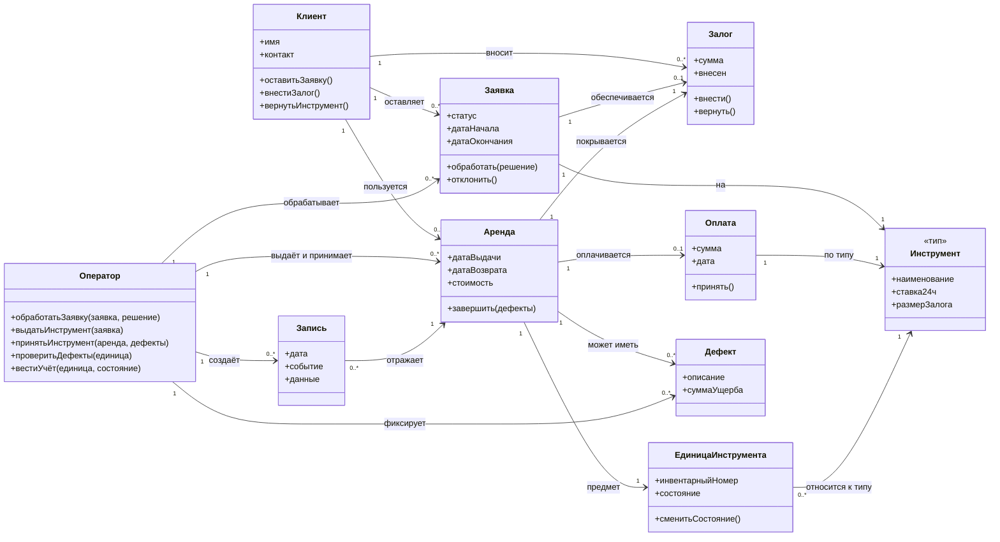

# Диаграмма классов

**Вопрос:** Какие классы участвуют в учёте аренды инструментов и как они связаны между собой?

## Пояснения к элементам

| Элемент | Пояснение |
|---|---|
| `Инструмент` / `ЕдиницаИнструмента` | Тип и конкретный экземпляр разделены — решение **D1** (ADR-001 в `decisions/`). |
| `Заявка.статус` | Статусы зафиксированы решением **D2**: `ОжидаетОбработки → ЗалогВнесён → Обработана → Закрыта`, ветка `Отклонена`. |
| `Заявка.датаНачала/датаОкончания` | Срок в сутках, максимум 14 + продление до 7 — решение **D3**. |
| `Залог.сумма` | Фиксирована по типу инструмента: 3000/2000/1500 ₽ — решение **D4**. |
| `Залог.вернуть()` | Возврат — полномочие оператора — решение **D5**. |
| `Оплата` | Плата за аренду отдельно от залога, принимается при выдаче — решение **D8**. |
| `Дефект.суммаУщерба` | Удержание не превышает залог (инвариант I14), излишек моделью не учитывается. |
| `Запись` | Журнал только пополняется — решение **D9**, инвариант I17. |

Роли по таблице прав: рабочие — только `Клиент` и `Оператор` (D10). Полный список решений D1–D14 — в `diagrams/diagrams.md`.
