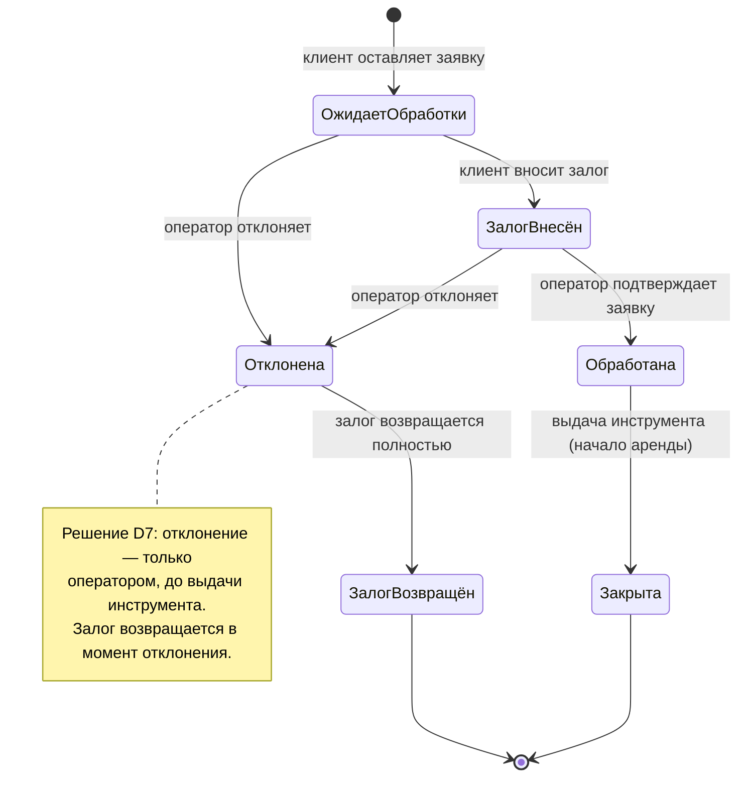
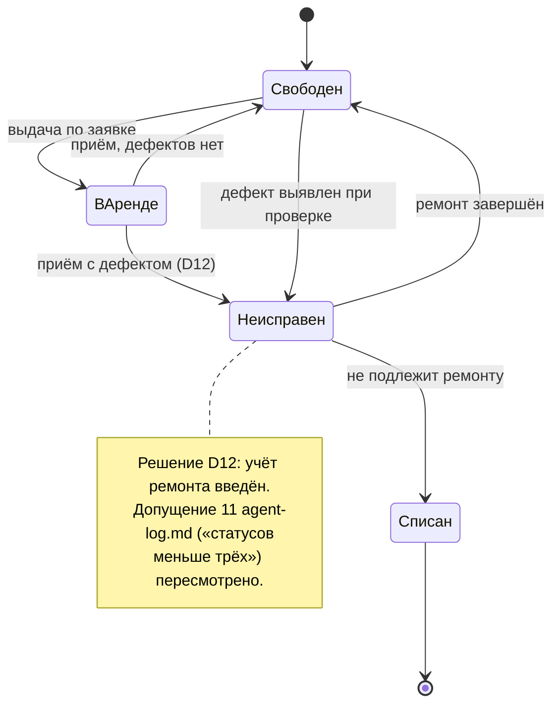
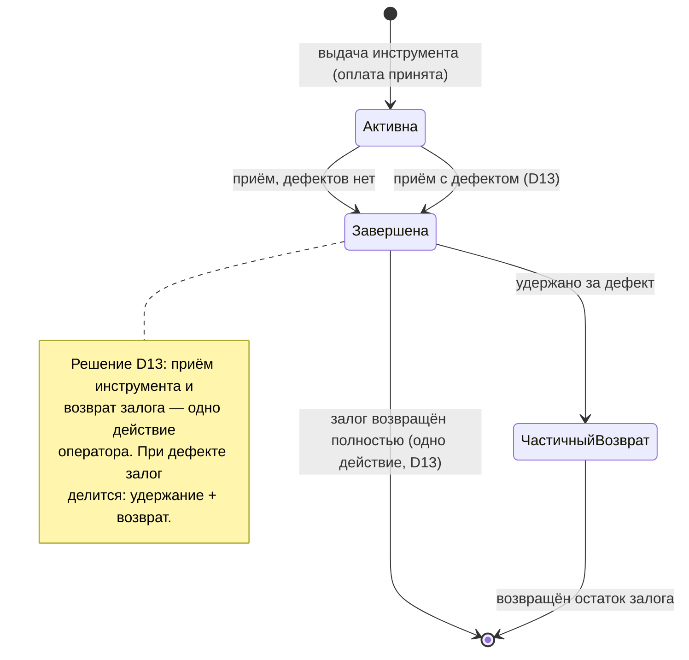

# Диаграммы состояний

## Заявка

**Вопрос:** Через какие состояния проходит заявка и кто их меняет?

## Единица инструмента

**Вопрос:** В каких состояниях бывает единица инструмента и что переводит её из одного состояния в другое?

## Аренда

**Вопрос:** Как проходит полный цикл аренды — от выдачи инструмента до возврата залога?

