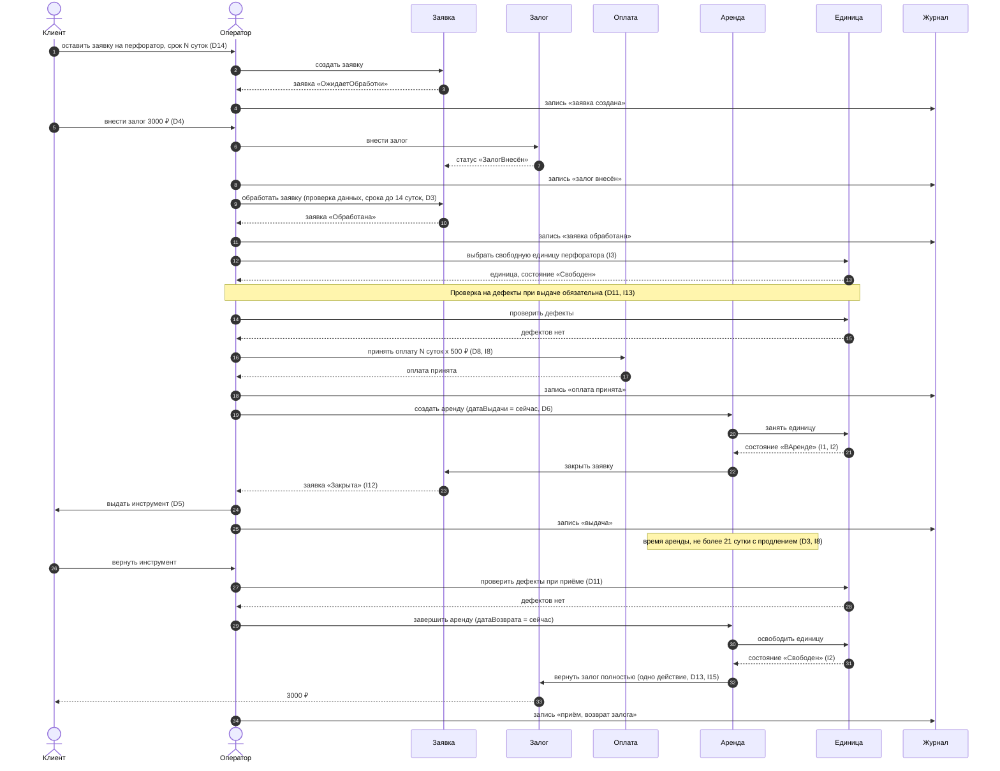
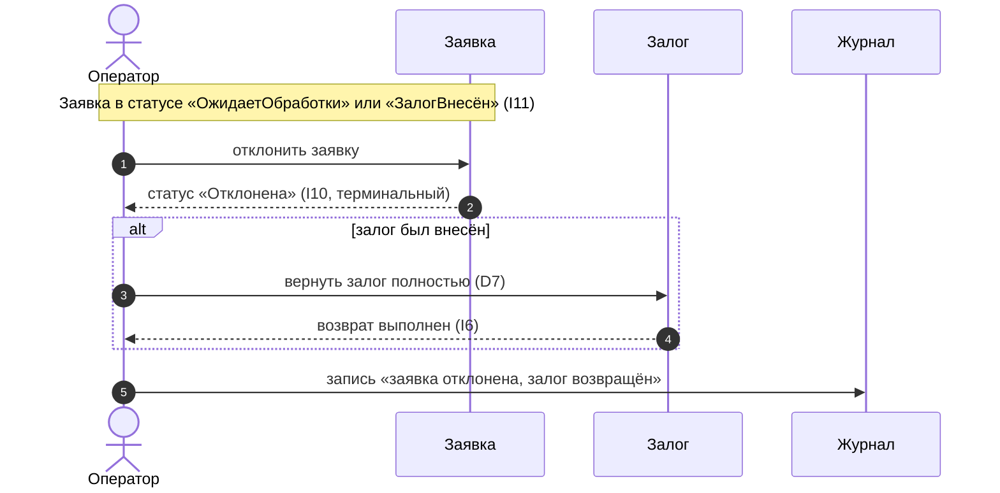
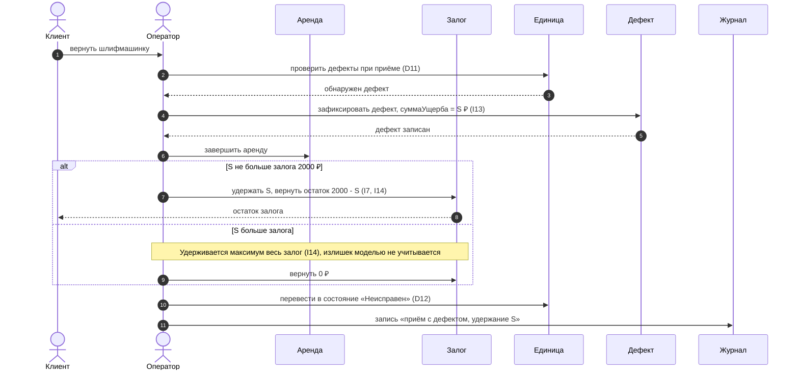

# Диаграмма последовательности

## Участники

| Участник | Роль |
|---|---|
| `Клиент` | актёр, инициирует заявку, залог, возврат |
| `Оператор` | актёр, единственная роль мастерской (D10) |
| `Заявка` | объект, хранит статус (D2) |
| `Залог` | объект, вход/выход денег по заявке |
| `Оплата` | объект, плата за аренду (D8) |
| `Аренда` | объект, период пользования (D6) |
| `Единица` | `ЕдиницаИнструмента`, состояние (D12) |
| `Журнал` | append-only записи (D9) |

## Основной поток

**Вопрос:** Что происходит между клиентом, оператором и системой при успешной аренде инструмента?

## Ветка A: отклонение заявки

**Вопрос:** Как отклоняется заявка и кто в этом случае возвращает залог?

## Ветка B: приём с дефектом

**Вопрос:** Что делает оператор, если возвращённый инструмент оказался с дефектом?

## Примечания

- Оплата и залог — разные потоки денег и не компенсируют друг друга (I9).
- Выдача возможна только при одновременном выполнении I5: залог + оплата + статус `Обработана`.
- Просрочка аренды и «висячие» заявки на диаграммах не показаны — в модели отсутствуют.
