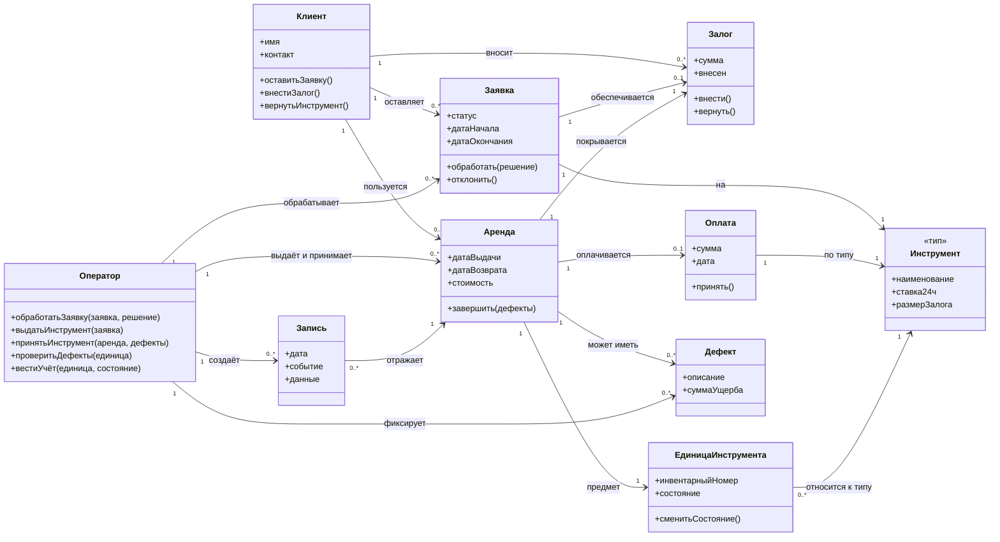
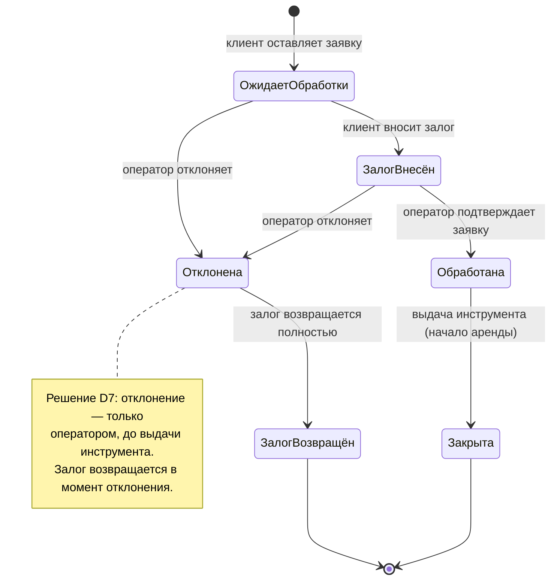
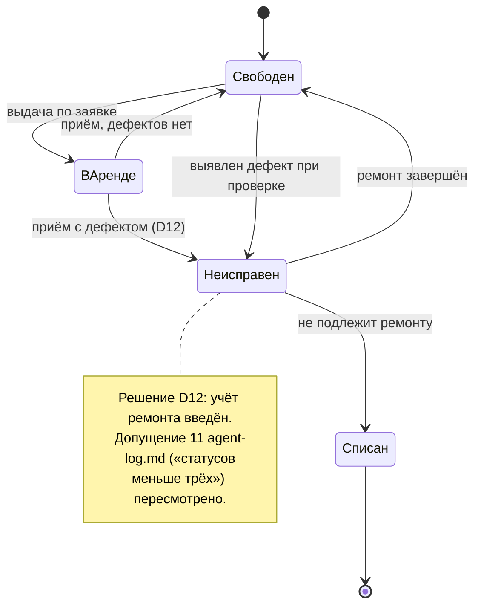
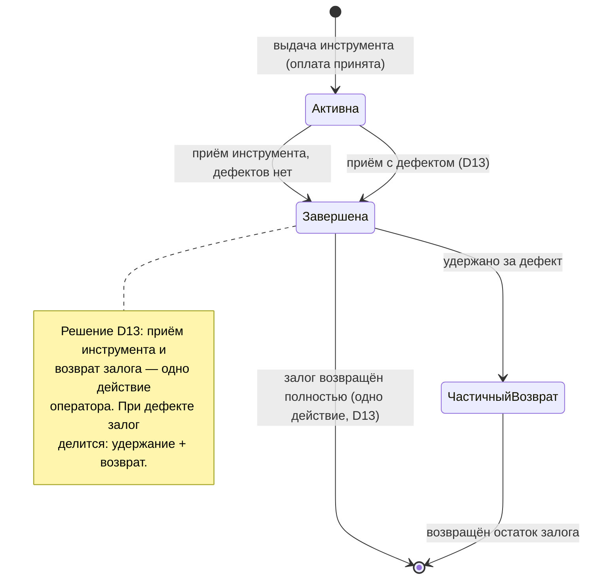

# Диаграммы системы учёта аренды инструментов

> Отдельный файл к `specification.md`. Все ранее открытые вопросы (`<<open>>`) закрыты решениями по усмотрению. Решения **не подтверждены текстом требования** — они фиксируются здесь и пронумерованы D1–D14. Список решений — раздел 4.

---

## 1. Диаграмма классов

---

## 2. Диаграммы состояний

### 2.1. Состояния заявки

### 2.2. Состояния единицы инструмента

### 2.3. Состояния аренды (полный цикл)

---

## 3. Связь с замечаниями проверки

| Замечание | Как закрыто |
|---|---|
| **A1** («неисправен» против допущения 11) | D12: состояния расширены (Свободен, В аренде, Неисправен, Списан). Допущение 11 пересмотрено явно. |
| **A2** (кто возвращает залог) | D6: возврат залога — полномочие оператора. |
| **A3** (приём и возврат залога — один шаг) | D13: одно действие; при дефекте залог делится на удержание и возврат. |
| **A4** (кто решает по залогу при дефекте) | D12/D13: оператор, сумма ущерба фиксируется в `Дефект.суммаУщерба`. |
| **A5** (оплата аренды) | D8: класс `Оплата`, принимается оператором при выдаче. |
| **A7** (порядок заявка → залог) | D2: зафиксирован порядок «заявка → залог → обработка». |
| **A8** (проверка дефектов при выдаче) | D11: проверка обязательна и при выдаче, и при приёме. |
| **B1** (нет действия «получить инструмент») | D5: выдача — одно действие оператора; отдельной операции «получение» нет. |
| **B3** (статусы заявки нигде не определены) | D2: статусы зафиксированы (раздел 2.1). |

---

## 4. Принятые решения (D1–D14)

| № | Решение |
|---|---|
| **D1** | `Инструмент` — тип (перфоратор, шлифмашинка, лестница); `ЕдиницаИнструмента` — конкретный экземпляр с инвентарным номером. У типа может быть несколько единиц. |
| **D2** | Статусы заявки: `ОжидаетОбработки → ЗалогВнесён → Обработана → Закрыта`; ветка `Отклонена`. Порядок: заявка создаётся до внесения залога. Отклонить может только оператор. |
| **D3** | Срок аренды — в сутках. Заявка содержит дату начала и дату окончания. Максимум — 14 суток, продление — ещё до 7 суток по решению оператора. |
| **D4** | Залог — фиксированная сумма по типу инструмента, рубли, наличные: перфоратор — 3000 ₽, шлифмашинка — 2000 ₽, лестница — 1500 ₽. |
| **D5** | Возврат залога — полномочие оператора. Отдельной операции «клиент получает инструмент» нет: момент передачи — действие оператора «выдать». |
| **D6** | Аренда: начало — момент выдачи, окончание — момент приёма. |
| **D7** | Отклонение заявки: оператор, до выдачи; залог возвращается полностью в момент отклонения. |
| **D8** | Оплата аренды существует отдельно от залога: стоимость = ставка за сутки × сутки, принимается оператором наличными при выдаче. Ставки: перфоратор — 500 ₽/сутки, шлифмашинка — 400 ₽/сутки, лестница — 300 ₽/сутки. |
| **D9** | Записи (журнал) — только пополняемый: редактирование и удаление запрещены. Фиксируются все события: создание заявки, залог, обработка, выдача, оплата, приём, дефекты, возврат залога. |
| **D10** | Роли — только две: `Клиент` и `Оператор`. Дополнительных ролей нет. |
| **D11** | Проверка на дефекты обязательна при выдаче и при приёме. |
| **D12** | Состояния единицы инструмента: `Свободен`, `В аренде`, `Неисправен`, `Списан`. Допущение 11 agent-log.md пересмотрено. |
| **D13** | Приём инструмента и возврат залога — одно действие оператора. При обнаруженном дефекте оператор удерживает из залога `суммаУщерба` (не более залога) и возвращает остаток. |
| **D14** | Клиент идентифицируется именем и контактом (телефон); регистрация не нужна. Данные вносятся оператором при оформлении заявки. |

> Все решения — по усмотрению, требованием не подтверждены. Если заказчик их отклонит, правятся только этот файл и `specification.md` в отмеченных местах.
