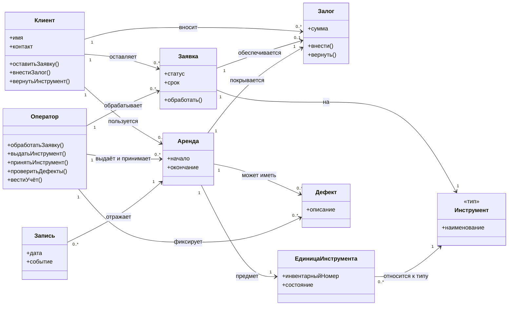
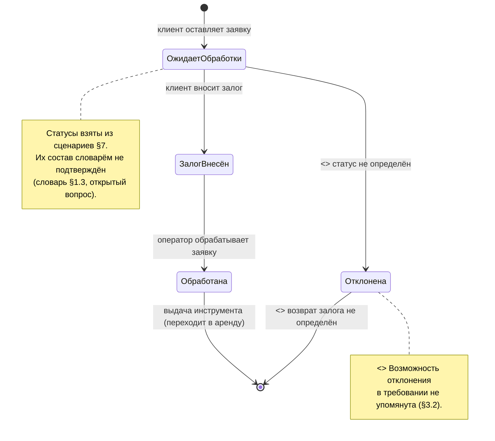
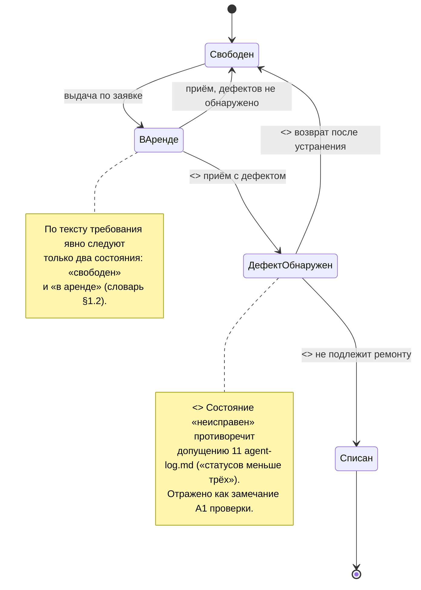
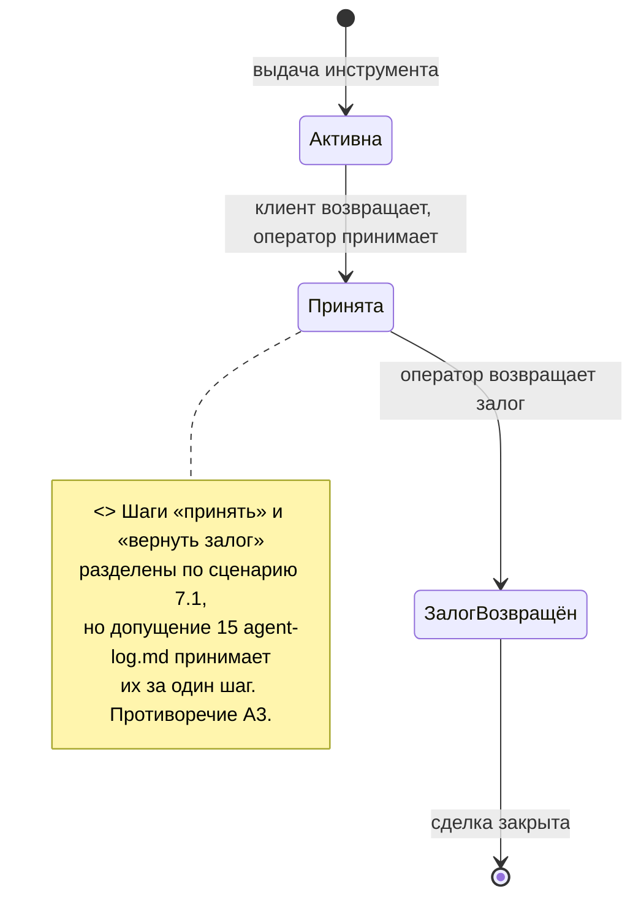

# Диаграммы системы учёта аренды инструментов

> Отдельный файл к `specification.md`. Диаграммы построены по словарю (§1), таблице прав (§4) и сценариям (§7). Элементы, не подтверждённые текстом требования, помечены стереотипом `<<open>>` и пояснением — решения в диаграммы не добавляются.

---

## 1. Диаграмма классов

### Пояснения к классам (открытые вопросы)

| Элемент | Отметка |
|---|---|
| `Инструмент` / `ЕдиницаИнструмента` | `<<open>>` Требование не разделяет тип и экземпляр (словарь §1.2, вопрос 1–2). Разделение принято только для того, чтобы сценарий 7.4 (два клиента — одна лестница) был вообще формулируем. |
| `Заявка.статус` | `<<open>>` Состав статусов не определён (словарь §1.3). Значения взяты из сценариев §7: «ожидает обработки», «залог внесён», «обработана». |
| `Заявка.срок` | `<<open>>` Поле «на какой срок» упомянуто в словаре, единица измерения не определена. |
| `Залог.сумма` | `<<open>>` Способ определения суммы не определён (agent-log, вопрос 11). |
| `Залог.вернуть()` | `<<open>>` Полномочие на возврат отсутствует в таблице прав (замечание A2 проверки). |
| `Аренда.начало/окончание` | `<<open>>` Привязка к событиям «выдача»/«приём» следует из словаря, но начало отсчёта срока не определено (сценарий 7.1, шаг 4). |
| `Дефект` | `<<open>>` Связь «Дефект → удержание из залога» в требовании отсутствует; решение не моделируется. |
| `Оплата аренды` | `<<open>>` Сущность в словаре отсутствует; в диаграмму не включена (замечание A5). |
| `Запись` | `<<open>>` Словарь §1.6 допускает журнал, но его необходимость и формат не подтверждены. |
| Роли | По таблице прав (§4) рабочие роли только две: `Клиент` и `Оператор`. |

---

## 2. Диаграмма состояний

### 2.1. Состояния заявки

### 2.2. Состояния единицы инструмента

### 2.3. Состояния аренды (полный цикл из сценария 7.1)

---

## 3. Связь с замечаниями проверки

- **A1** — состояние «неисправен» на диаграмме 2.2 помечено как `<<open>>` (противоречие со статусом допущения).
- **A3** — разделение «Принята → ЗалогВозвращён» на диаграмме 2.3 помечено как `<<open>>`.
- **A5** — оплата аренды отсутствует в классовой диаграмме, поскольку её существование не подтверждено.
- **B1** — действие «получить инструмент» в таблице прав отсутствует; на диаграмме классов его не создаём, выдача отнесена к оператору.
